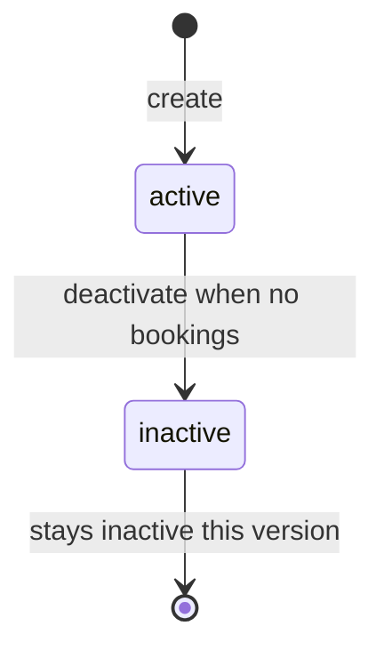
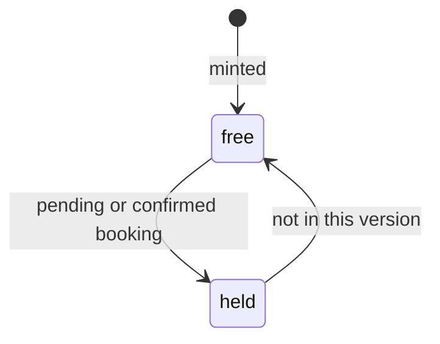
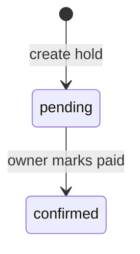
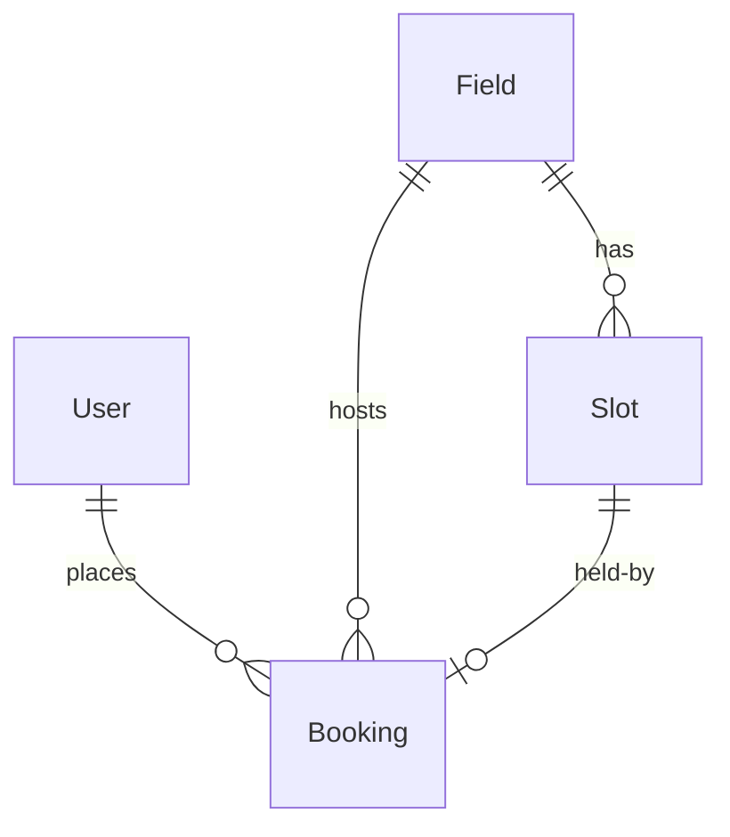

# Functional Spec — u1-venue-booking

## Sources

- Entities and rules in this folder. [entities] [rules]
- C1 façade. [contract-summary]
- Requirements FR1–FR4, NFR2. [requirements]
- Answers [Q1]–[Q5].

## Workflows

### W1 Register player

1. Caller sends email, password, full name to `POST /register`. [Q1]
2. If email exists, refuse 409 (BR1.1).
3. Create User with role player (BR1.3).
4. Return 201. Caller then logs in (W2).

### W2 Login

1. Caller sends email and password to `POST /session`.
2. Match credentials (BR1.2) or 401.
3. Return 200 with a session the later calls carry.

### W3 Owner adds or edits a field

1. Owner session required (BR1.4).
2. Add: `POST /fields` with name and price (BR2.1) → 201.
3. Edit: `PUT /fields/{fieldId}` (BR2.2) → 200.
4. Duplicate name → 409. Unknown id → 404.

### W4 Owner deactivates a field

1. Owner session (BR1.4).
2. If any pending or confirmed booking exists on the field, refuse 409 (BR2.4). [Q3]
3. Else set Field status inactive (BR2.5).

### W5 Browse fields and slots (no login)

1. `GET /fields` returns active fields (owners also see inactive) (BR2.3, BR2.6).
2. `GET /fields/{fieldId}/slots` returns minted slot ids with free or held (BR3.1–BR3.4). [Q5]

### W6 Player holds a slot

1. Player session (BR1.5).
2. `POST /bookings` with slot id (BR3.2).
3. If slot free and field active: pending unpaid Booking, slot held (BR4.1, BR3.3).
4. Else 409; do not retry as a new booking (BR4.3, BR4.4).

### W7 Owner books on behalf of a player

1. Owner session (BR1.4).
2. Body names the player’s registered email (BR4.2). [Q2]
3. Unknown player → 404. Same hold rules as W6.

### W8 Owner marks paid

1. Owner session (BR1.4).
2. `POST /bookings/{bookingId}/paid` (BR4.5).
3. Pending → confirmed, payment paid, confirmationRef set.
4. Player-facing confirmation screen is U2 (FR4.5).

### W9 Owner lists bookings

1. Owner session.
2. `GET /bookings` returns every booking (BR4.6).

## State machines

### Field

Text fallback: A field is created active. Deactivate is allowed only when no pending or confirmed booking exists. This version does not reactivate.

### Slot

Text fallback: A minted slot is free until a pending or confirmed booking holds it. Cancel is out of scope, so held does not return to free here.

### Booking

Text fallback: A booking starts pending and holds the slot. Mark-paid moves it to confirmed.

## Entity relationship (derived from entities.md)

Text fallback: User has many bookings. Field has many slots and bookings. Slot has at most one booking.

## Rules summary (derived from rules.md)

Register and login are separate paths. The first owner is seeded. Collision is 409. Deactivate waits until no bookings remain. Slots are identified by minted ids. Owner-on-behalf uses an existing player email.

## Assumptions & Open Questions

- Assumption: Session token or cookie name is chosen in Code Generation; this spec only requires a session after login. [contract-summary]
- Assumption: Slot rows are minted when an owner or browser asks for a day’s hours, not all future hours at once.
- Open question: None.
