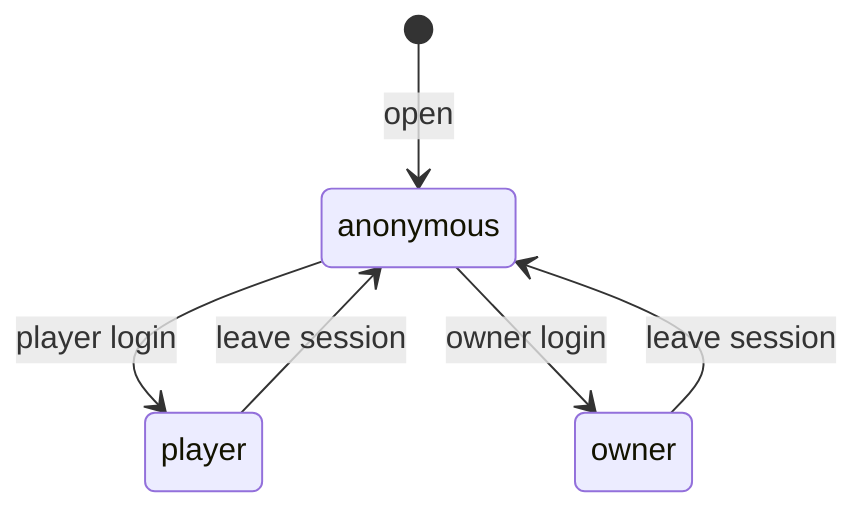
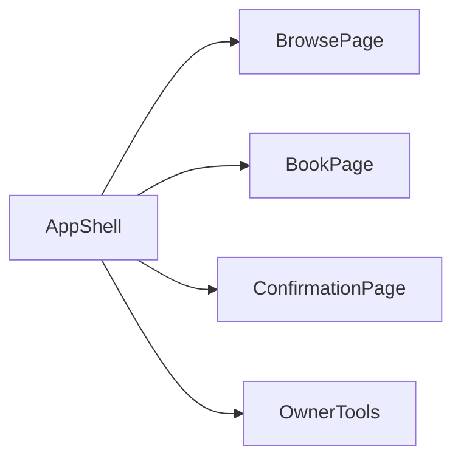

# Functional Spec — u2-web-ui

## Sources

- Unit U2. [unit-of-work]
- Frontend components and rules in this folder. [frontend-components] [rules]
- C1. [contract-summary]
- Answers [Q1]–[Q4].

## Workflows

### W1 Browse without login

1. Open the app. AppShell has no owner tools. [Q4]
2. GET /fields and GET /fields/{id}/slots?date= for the chosen day. [FR2.5] [FR3.3]
3. Taken hours show as held; free hours can be chosen after login.

### W2 Register and login

1. Register as player (POST /register), then login (POST /session).
2. Owner logs in with the seeded owner account from U1.

### W3 Player books

1. Player session required. Choose a free slot. POST /bookings with slotId. [FR4.1]
2. On 201, go to ConfirmationPage (pending).
3. On 409, show that the slot was taken, refresh slots, do not POST again. [Q3]
4. On 10s timeout, show failure; do not retry. [BR5.8]

### W4 Owner books on behalf

1. Owner tools visible. Form: slot + player email. POST /bookings. [FR4.2]
2. Unknown email: show 404 from U1.

### W5 Owner mark-paid and list

1. OwnerBookingsPage GET /bookings. [FR4.6]
2. Mark paid POST /bookings/{id}/paid.
3. Player reopens ConfirmationPage; GET /bookings/{id} shows confirmationRef. [Q1] [FR4.5]

### W6 Owner field tools

1. Add, edit, deactivate via U1. Deactivate 409 (bookings remain) is shown as “clear those bookings first” without inventing cancel.

## Screen / session states

Text fallback: Anonymous can browse. Player login unlocks book and confirmation. Owner login unlocks owner tools in the same shell. [Q4]

## Entity relationship

U2 owns no domain entities. Shapes come from U1.

Text fallback: One shell; owner tools only with an owner session.

## Rules summary (derived)

Confirmation is an in-app page with confirmationRef. Layout is desktop-first. 409 refreshes slots. Owner tools share the shell.

## Assumptions & Open Questions

- Assumption: U1 base URL is a build-time setting, not a product question.
- Open question: None.
