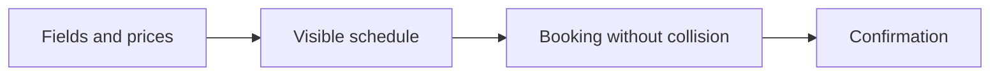

# Scope Document

## Sources

- [desc] Initial description: "Build simple football field management base on this requirements document football-field-management-system.md"
- [scope] Workflow-selected scope: `classic`.
- Intent statement: players book a free slot with a confirmation; two people cannot take the same slot; the owner adds fields, sets prices, and sees every booking. Out of the first version: public hosting, real card payments, admin charts, rescheduling, peak-hour pricing, recurring schedules. [intent-statement]
- [Q1] First slice that still delivers value: owner-only — the owner or staff books on behalf of players.
- [Q2] Must / Should / Won't ranking for the first version.
- [Q3] Dependency order: fields and prices, then a schedule, then a booking that cannot collide, then a confirmation.
- [Q4] Sequencing preference: dependency-first (fields and prices before any booking).
- [Q5] No hard date.
- [Q6] One venue, several fields the owner can add.

## Product boundary

This first version is a simple football field management system for **one venue** with **several fields** the owner can add. [Q6] [intent-statement]

The **smallest slice that still delivers value** is owner-only: the owner keeps fields, prices, and the book, and books on behalf of players. [Q1]

The **first-version loop** still includes a player booking a slot, a confirmation the player keeps, and protection against two people taking the same slot, once fields and prices exist. [Q2] [intent-statement]

There is no hard date; ship when that first-version loop works. [Q5]

## In scope

| Capability | Why it is in | Source |
| --- | --- | --- |
| Owner adds and lists fields at one venue | First thing in the dependency order; several fields | [Q3] [Q4] [Q6] |
| Owner sets prices | Required before a booking has a price | [Q3] [Q4] [intent-statement] |
| Visible schedule of free and taken slots | Needed before a booking can be chosen | [Q3] [intent-statement] |
| Booking a slot without a double booking | Core success metric | [Q2] [intent-statement] |
| Owner sees every booking | Owner-only first slice and first-version Must | [Q1] [Q2] |
| Owner books on behalf of a player | Smallest valuable slice | [Q1] |
| Player books a free slot | First-version Must | [Q2] [intent-statement] |
| Player keeps a confirmation | First-version Must, last in the dependency order | [Q2] [Q3] |

## Out of scope (this first version)

| Left out | Source |
| --- | --- |
| Public hosting | [intent-statement] [Q2] |
| Real card payments | [intent-statement] [Q2] |
| Admin charts | [intent-statement] [Q2] |
| Rescheduling | [intent-statement] [Q2] |
| Peak-hour pricing | [intent-statement] [Q2] |
| Recurring schedules | [intent-statement] [Q2] |
| Several venues | [Q6] |

Cancel a booking is **Should Have**, not Must: include if time allows, not required for the first-version loop. [Q2]

## Sequencing

Work **dependency-first**: fields and prices before any booking. [Q4]

Order of value: fields and prices → schedule → a booking that cannot collide → a confirmation the player keeps. [Q3]

The owner-only booking path is the first slice; player-facing booking follows once that path is real. [Q1] [Q3]

Text fallback: Fields and prices, then a visible schedule, then a booking that cannot collide, then a confirmation.

## Value stream

| Step | Who benefits | Outcome |
| --- | --- | --- |
| Owner records fields and prices | Owner | A venue has bookable fields with prices |
| Schedule shows free and taken slots | Owner, then player | Nobody guesses availability |
| A slot is booked once | Owner, player | Two people cannot take the same slot |
| Confirmation is kept | Player (or the person the owner booked for) | The reservation is something they can show |

## Assumptions & Open Questions

- Assumption: Q1 (owner books on behalf of players as the smallest slice) does not cancel Q2 or the intent statement. Player-facing booking remains a first-version Must; it is not the first slice. [Q1] [Q2] [intent-statement]
- Assumption: "Several fields" means more than one field at a single venue, added by the owner, not a marketplace of venues. [Q6]
- Open question: None.
